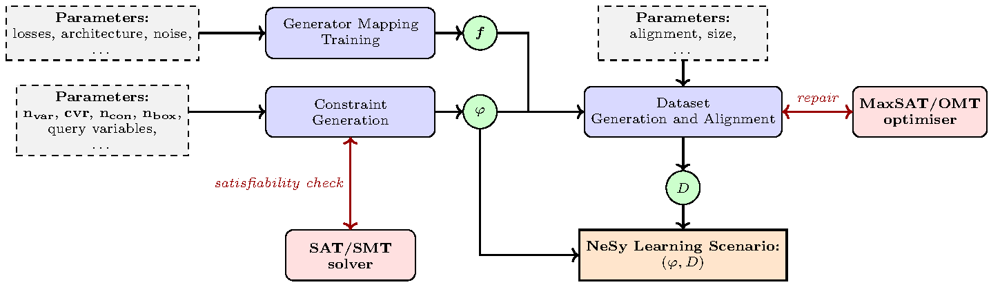

# NeSySy: Synthetic Neurosymbolic Task Generation with Controlled Constraint Complexity

[](https://github.com/mikl123/NeSySy-bench/actions/workflows/ci.yml)
[](https://arxiv.org/abs/2611.19597)
[](LICENSE)

**NeSySy** (**Ne**uro**Sy**mbolic **Sy**nthetic tasks) generates synthetic neurosymbolic learning tasks. A task combines a random constraint over input and output variables (propositional, bounded intervals over reals, or linear inequalities over reals) with a dataset whose input-output pairs satisfy it. A few parameters, such as the clause-to-variable ratio, control how hard the task is. NeSySy also contains the learners compared in the accompanying paper ([arXiv:2611.19597](https://arxiv.org/abs/2611.19597)): Base, Base+corr, CCN+, DRL, BaseSeq and DeepProbLog.

<a href="NeSySy.png"></a>

- [Installation](#installation)
- [Quick start](#quick-start)
- [Concepts](#concepts): constraints, dataset generation, learning methods
- [Reproducing the paper's results](#reproducing-the-papers-results)
- [Repository layout](#repository-layout)
- [Documentation, examples and tests](#documentation-examples-and-tests)
- [Contributing](#contributing)
- [Citation](#citation)

## Installation

NeSySy needs Python ≥ 3.12 on Linux or macOS (x86-64 or arm64). No GPU is needed.

**To reproduce the paper's results**, use the install script. It creates a virtual environment in `.venv` with the exact dependency versions used for the paper (about 3 minutes):

```bash
./install.sh                       # or: PYTHON=python3.13 ./install.sh
```

It ends with `OK: torch 2.11.0..., z3 4.16.0, mlflow 3.11.1` and `Installation finished`. Nothing is installed outside `.venv`.

**To use NeSySy as a library** in your own environment:

```bash
pip install "pishield @ git+https://github.com/mikl123/PiShield.git@3a7dae2af0b0eecff0fe19f3d6d229b5453b577b" -c constraints.txt
pip install -r requirements.txt -c constraints.txt
pip install -e .
```

On Linux without a GPU, first install the much smaller CPU-only PyTorch: `pip install torch==2.11.0 --index-url https://download.pytorch.org/whl/cpu`.

## Quick start

```python
import torch
from nesy_data_gen.constraints import CNFConstraint
from nesy_data_gen.generators import DatasetGeneratorFixGuided
from nesy_approaches.methods import ALL_METHODS, evaluate
from sklearn.model_selection import train_test_split

# 1. Generate constraint
cnf = CNFConstraint(n_outputs=10, n_inputs=4, k=3, r=2.0, seed=42)
cnf.generate()

# 2. Generate dataset
gen = DatasetGeneratorFixGuided(n_inputs=4, n_outputs=10, n_samples=1000, epochs=200)
dataset = gen.generate_dataset(cnf, seed=42)
X = torch.as_tensor(dataset["X"], dtype=torch.float32)
Y = torch.as_tensor(dataset["Y"], dtype=torch.float32)

# 3. Split
x_train, x_test, y_train, y_test = train_test_split(X, Y, test_size=0.2, random_state=0)
x_train, x_val, y_train, y_val   = train_test_split(x_train, y_train, test_size=0.1, random_state=0)

# 4. Train and evaluate
config = {"hidden_dim": 64, "num_layers": 2, "epochs": 500, "lr": 0.001,
          "batch_size": 64, "patience": 20, "device": "cpu"}

predicted, _ = ALL_METHODS["plain_nn"](x_train, y_train, x_val, y_val, x_test, cnf, config)
print(evaluate(predicted, y_test, x_test, cnf))
# {"results_per_region": {...}, "binary_cross_entropy": ..., "hamming_distance": ...,
#  "accuracy": ..., "constraint_violation_ratio": ...}
```

The same code is in [`simple_example.py`](simple_example.py). [`examples/`](examples/) contains one minimal pipeline per learner and constraint type, and shows how to plug in your own constraint ([`custom_constraint_example.py`](examples/custom_constraint_example.py)) or generator mapping ([`custom_generator_function_example.py`](examples/custom_generator_function_example.py)).

## Concepts

### Constraints

| Type | Variables | Literal form | Solver |
|------|-----------|-------------|--------|
| `CNFConstraint` | Boolean | `x` or `¬x` | pysat (SAT/MaxSAT) |
| `SMTBoundedIntervalConstraint` | Real [0,1] | `lo ≤ x ≤ hi` | Z3 (SMT/Optimize) |
| `SMTLinearInequalityConstraint` | Real [0,1] | `c₀ + c₁x₁ + ... ≤ 0` | Z3 (SMT/Optimize) |

All constraints share a propositional CNF backbone, with atoms replaced by linear inequalities for real-valued variables. New constraint types subclass `Constraint` in `nesy_data_gen/constraints/base.py`; `CNFConstraint` (`cnf.py`) and `SMTConstraint` (`smt.py`) are complete examples.

### Dataset generation

Dataset generation starts with training a **generator mapping** neural network. The training objective is a weighted sum of one or more of the following losses. Weights and additional loss functions can be provided by the user.

| Loss | Key name | Effect |
|------|----------|--------|
| `SoftRepulsionLoss` | `soft_repulsion` | Pushes output pairs apart — primary diversity signal (default) |
| `DecorrelationLoss` | `decorrelation` | Penalises linear dependence between output dimensions |
| `SmallEntropyLoss` | `small_entropy` | Pushes each output toward 0 or 1 (sharpens Boolean predictions) |
| `LargeEntropyLoss` | `large_entropy` | Pushes batch mean of each dimension toward 0.5 (balances classes) |
| `L1RegularizationLoss` | `l1` | L1 weight regularisation |
| `ConstraintLoss` | `constraint` | Penalises distance to nearest constraint-satisfying point |

The generated samples are then aligned with the constraint:

- **Filtering** (`DatasetGeneratorFiltering`) keeps only the samples that already satisfy the constraint, and resamples near valid samples until the quota is reached. The samples stay close to the generator mapping, but there may be fewer than requested when the feasible region is small.
- **Fixing** (`DatasetGeneratorFixGuided`) projects every output to the nearest feasible value via `constraint.fix()`, then perturbs boundary points inward with Gaussian noise. It always returns the requested number of samples, at the cost of more distortion.

| | Filtering | Fixing |
|---|---|---|
| Output count | May be less than `n_samples` | Exactly `n_samples` |
| Output distortion | Low (only natural satisfiers kept) | Higher (fix projection applied to all) |
| Used for distant supervision | ✓ | ✗ |

### Learning methods

| Method (code) | Paper name | CNF | Real-valued | Constraint guarantee | Description |
|---|---|---|---|---|---|
| `plain_nn` | Base | ✓ | ✓ | No | Constraint-unaware base neural network |
| `plain_nn_postproc` | Base+corr | ✓ | ✓ | Yes (post-hoc fix) | Base with a symbolic solver invoked at inference to project outputs onto the feasible region |
| `pishield` | CCN+ / DRL | ✓ | ✓ | Yes (by construction) | Appends a differentiable enforcement layer (CCN+ for Boolean, DRL for real-valued) |
| `sequential_beam` | BaseSeq | ✓ | — | No | Autoregressively predicts one output variable at a time using beam search |
| `plain_nn_sl` | DeepProbLog | ✓ | — | No | Base trained through the constraint's probabilistic circuit (distant supervision) |
| `sequential_fix` | — | ✓ | — | Yes (SAT at each step) | BaseSeq extended with constraint enforcement via a SAT solver |
| `decision_tree` | — | ✓ | ✓ | No | Scikit-learn decision tree baseline |

All methods are implemented in `nesy_approaches/methods.py`. New learners are functions with the same signature added to `ALL_METHODS`; `evaluate` computes the paper's metrics for them.

## Reproducing the paper's results

After `./install.sh`, in the top directory:

```bash
./smoke_test.sh     # ~15 min: quick check that everything works
./run_subset.sh     # ~7 h: representative subset of the paper's results
./run_full.sh       # several days: all runs behind the paper's results
```

The figures and tables are written to `output/<smoke|subset|full>/paper_results/`, named after the paper (`fig3a.pdf`, `table1.csv`, …); [`reference/`](reference/) holds the paper's own results for comparison. `./run_full.sh --help` lists the single results that can be run on their own and the options. An archived version is available at https://doi.org/10.5281/zenodo.23640674.

## Repository layout

```
nesy_data_gen/         constraint and dataset generators (the tool)
nesy_approaches/       learning methods compared in the paper
docs/                  detailed documentation (see below)
examples/, simple_example.py   minimal pipelines
experiments/           one script per paper result:
  fig3_4_8_9_10_hardness.py, table1_fixing_vs_filtering.py, tables2_3_4_methods.py,
  fig7a_distant_cvr.py, fig7b_distant_constraint_weight.py, fig7c_distant_generator_depth.py,
  fig7d_distant_learner_depth.py
  analysis/            notebooks that draw the paper's figures and tables from the runs:
                       fig3_4_8_9_10.ipynb, table1.ipynb, tables2_3_4.ipynb, fig7.ipynb
reference/             the paper's own results
install.sh             installs the pinned dependencies into .venv
smoke_test.sh, run_subset.sh, run_full.sh   reproduce the paper's results
run.py                 the driver behind these scripts
requirements.txt, constraints.txt   pinned Python dependencies (requirements-dev.txt: development tools)
```

## Documentation, examples and tests

| Document | Contents |
|----------|----------|
| [`docs/constraints.md`](docs/constraints.md) | All constraint types: architecture, parameters, generation, checking, fixing, serialisation, examples |
| [`docs/datasets.md`](docs/datasets.md) | Dataset generation: pipeline, generator mapping, losses, alignment strategies, distant supervision, examples |
| [`docs/methods.md`](docs/methods.md) | All learning methods: plain NN, post-processing, PiShield, sequential models |

**New experiments:** add a preset to the `PRESETS` dictionary of `experiments/fig3_4_8_9_10_hardness.py` or `experiments/tables2_3_4_methods.py`. Every list in a preset can be overridden on the command line (`--help`).

**Tests:**

```bash
.venv/bin/python -m pytest nesy_data_gen/tests nesy_approaches/tests
```

**Development:** `pip install -r requirements-dev.txt` installs the formatting and linting tools; `pre-commit install` runs them on every commit.

## Contributing

Bug reports, questions and pull requests are welcome; see [`CONTRIBUTING.md`](CONTRIBUTING.md).

## Citation

If you use NeSySy, please cite the paper:

```bibtex
@misc{buleshnyi2026nesysy,
  title         = {Synthetic Neurosymbolic Task Generation with Controlled Constraint Complexity},
  author        = {Buleshnyi, Mykhailo and Zombori, Zsolt and Benedikt, Michael},
  year          = {2026},
  eprint        = {2611.19597},
  archivePrefix = {arXiv},
  url           = {https://arxiv.org/abs/2611.19597}
}
```

The citation metadata is also in [`CITATION.cff`](CITATION.cff), which GitHub shows as "Cite this repository".

## License

MIT, see [`LICENSE`](LICENSE).
